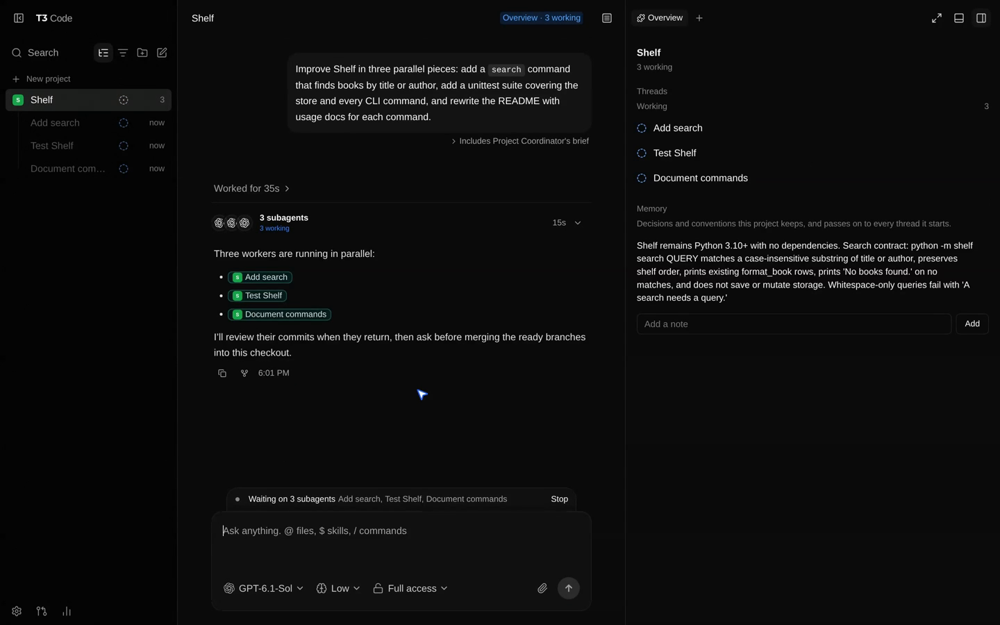
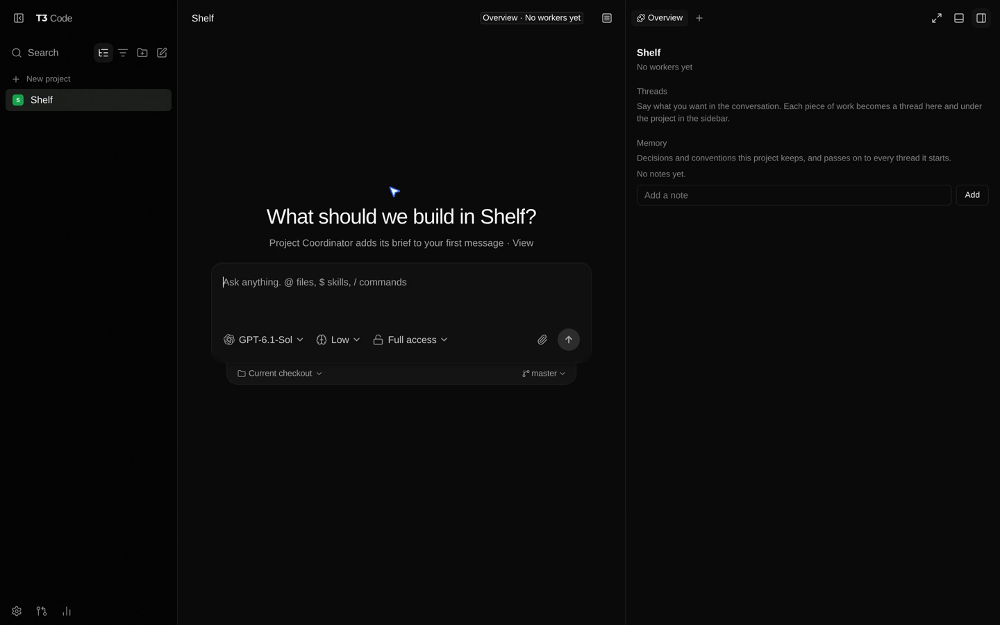
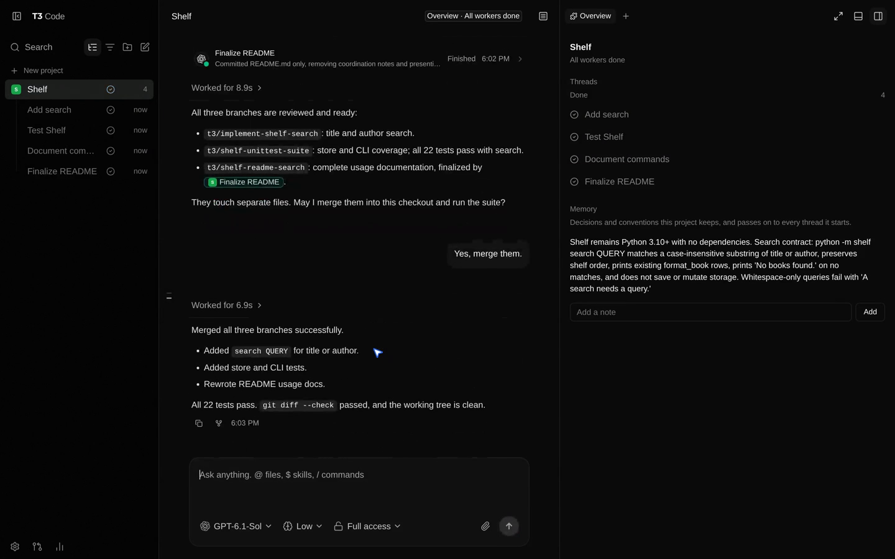

# Project Coordinator for T3 Code

A [T3 Code](https://github.com/pingdotgg/t3code) plugin, in the style of Claude Code Projects: each
project is one conversation. You say what you want, and the coordinator splits it into threads that
run in parallel, nested under the project, then reviews and merges their work.



## What you get

- **A Projects tab.** It lists the projects you've started, most recent first. Click one to open its
  conversation. Its threads nest underneath it with their live status; settled ones move to the
  Settled section at the bottom of the sidebar.
- **One conversation per project.** The coordinator plans the work, hands each piece to a thread in
  its own worktree, reviews what comes back, and asks before merging.
- **An Overview** beside the conversation. It groups threads into Ready for review, Waiting on you,
  Working and Done, and holds a short **project memory** that every thread gets.
- **Work across projects.** When work belongs to another project, the coordinator asks that
  project's coordinator instead of starting a worker there. The first time, T3 shows you a card;
  after **Add**, the project joins the sidebar with its own conversation, and its workers nest under
  it. Messages are labelled with the project they came from, and the reply comes back to the
  conversation that asked. The Overview lists those projects under **Other projects**.
- **Activity stays your inbox.** Project conversations and their threads show only in the Projects
  tab.

| Start a project                                                                       | Merged and done                                                                                            |
| ------------------------------------------------------------------------------------- | ---------------------------------------------------------------------------------------------------------- |
|  |  |

## Install

This needs a T3 Code build with the plugin system. It isn't in official T3 Code yet, so for now use
the [`plugin-system` branch](https://github.com/Zeus-Deus/t3code/tree/plugin-system). Version 0.2
needs a build that can ask for a project from a conversation; older builds refuse it.

1. Clone this repo.
2. In T3 Code, open **Settings → Plugins** and install the folder by its path, or install it from
   this repo's Git URL.
3. Review the permissions, grant the projects you want to coordinate, and approve.
4. In the sidebar, pick the **Projects** tab, then **+ New project**.

## Good to know

- **Removing a project** archives its conversation, keeping its history and memory. Adding it again
  brings the same conversation back.
- **Disabling the plugin** puts those conversations back in Activity, so nothing is lost.
- **Agents** can read the playbook and the project memory through `t3_plugin_invoke`, using the
  `guide`, `memory-read` and `memory-append` actions. Project coordinators reach each other with
  `ask-project` and `reply-project`.
- **Not now** on a project card sends nothing, and T3 won't ask about that project again until you
  next write in that conversation.
- **Removing the plugin's access** to a project takes it out of the Overview; rows already in a
  conversation stop naming it. The plugin keeps a short preview of the latest 100 messages between
  projects, and each conversation shows only its own.

## Development

```sh
node --test tests/
```

## License

MIT
